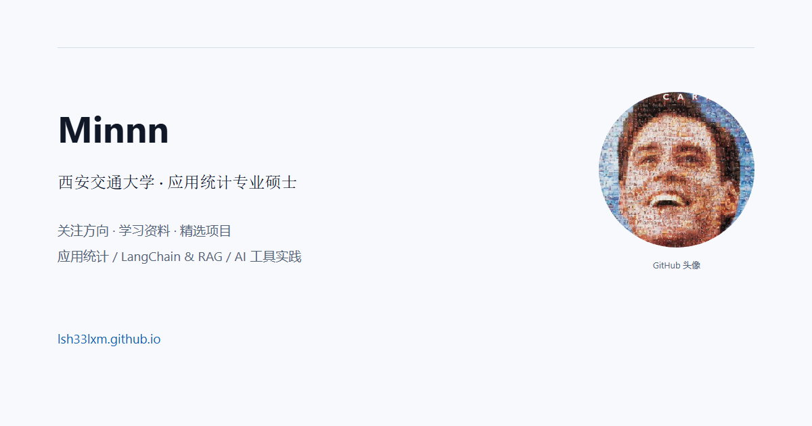

# Minnn 的个人主页



**应用统计、AI 工具实践与学习记录。** 页面采用浅色学术个人主页格式，930px 外层容器（正文有效宽度 900px）、34px 姓名、16px 衬线正文与 1.75 行高。栏目顺序为「姓名与身份 → 简介与头像 → 关注方向 → 近期动态（非空时）→ 最新文章 → 精选项目」。导航和辅助信息使用无衬线字体。

- 网站：<https://lsh33lxm.github.io/>
- 仓库：<https://github.com/lsh33lxm/lsh33lxm.github.io>
- 原生 HTML / CSS，无框架、无运行时 API、无外部字体或追踪脚本。
- Node.js 仅用于本地生成与预览；GitHub Pages 直接发布完整 HTML。主要内容不依赖 JavaScript。

## 本地预览

需要 Node.js 18 或更高版本。无需 `npm install`。

```powershell
cd D:\proj\0.githubio
npm run build
npm start
```

打开 <http://127.0.0.1:4173/>。按 `Ctrl+C` 停止。端口冲突时先运行 `$env:PORT = '4174'`。修改数据后重新运行 `npm run build`，刷新浏览器。

## 文件与维护

| 文件 | 用途 |
| --- | --- |
| `content/site.json` | **主要编辑入口**：个人资料、项目、文章、关注方向、更新日期、来源与待补充项 |
| `.gitattributes` | 统一文本换行，保证 Windows 和线上检出的构建一致 |
| `templates/index.html` | 语义化页面模板，需改布局时编辑 |
| `assets/style.css` | 色彩、字体、留白、手机布局、减少动态效果 |
| `assets/avatar.png` | 本地保存的公开 GitHub 头像（人物拼贴图，非本人照片） |
| `assets/favicon.svg` | 蓝色 M 字母图标 |
| `assets/share.png` | 1200 × 630 分享预览图 |
| `scripts/build.mjs` | 校验数据并生成完整 HTML、sitemap、robots |
| `scripts/serve.mjs` | 只绑定本机的静态预览服务 |
| `scripts/check-browser.cjs` | 可选：响应式、键盘与无障碍自动检查 |
| `scripts/share-image.cjs` | 可选：重新生成分享图 |
| `index.html` / `sitemap.xml` / `robots.txt` | 构建产物，**需要提交**；不要直接编辑 |

### 修改个人资料

编辑 `profile.name`、`identity` 与 `about`（介绍段落数组）；同时更新 `site.title`、`site.description` 与 `site.updated`。姓名直接作为主标题，不再使用宣传式首屏标题。旧版的 `intro`、`summary` 已移除。

`profile.email` 默认为 `null`；填入你确认愿意公开的邮箱后，头像旁自动出现邮件入口。`profile.photo` 为 `assets/` 中的本地图片路径，需同时填写 `photoAlt`（替代文本）和可选 `photoCaption`（图注）。当前头像来自 GitHub 公开资料，明确标为「GitHub 头像」，不是本人照片。设为 `null` 会自动切换为完整文字布局，联系链接放在简介之后，不生成占位圈。运行时不会请求 GitHub 头像服务。`verification` 只用于维护，不显示在网页上。

### 添加项目

在 `projects` 中复制一条，修改：

```json
{
  "title": "项目中文标题",
  "name": "仓库或工具名称",
  "kind": "工具项目 / 资料整理 / 教程复现 / fork",
  "description": "它解决什么问题，如何解决。",
  "contribution": "你实际完成的工作；若只有仓库功能证据，请只写实现范围。",
  "url": "https://github.com/lsh33lxm/真实仓库名",
  "source": "README、源码或你确认的个人分工依据。"
}
```

示例值仅供编辑说明，不会显示在网站。不能因为仓库不是 fork 就推断全部内容原创；教程整理必须保留来源，不把工具功能扩大成个人独立贡献。

页面以 `name` 显示项目名，按纵向条目呈现简介、性质与工作范围。`title` 保留为内部中文概括。可选的 `readme`、`demo` 字段只在填入真实 HTTPS 链接时生成 Readme / Demo 入口；Code 使用 `url`。资料库暂无根目录 README，因此只显示 Code。没有经过核实的项目截图时保持纯文字格式。

### 添加文章

在 `writing.items` 中增加一项；核实小红书单篇标题与稳定链接后，可放入 `writing.xiaohongshuItems`，它会出现在小红书入口下方。

```json
{
  "title": "已经核实的文章标题",
  "category": "统计学习 / 项目复盘 / 小红书笔记",
  "date": "2026-10-14",
  "url": "https://真实的文章地址"
}
```

日期未知时使用 `"date": null` 或省略日期字段，页面不会补造日期。不要提交 Cookie、访问令牌或临时签名链接。资料库条目的日期目前来自目录与文件名，不等同于额外核实过的发表日期；「最新文章」栏目中的现有条目仍明确作为学习记录与归档材料展示。

### 关注方向与近期动态

`interests` 保留兴趣条目，页面展示标题与简短描述。只能表述关注、学习或实践，不将其包装为已取得的研究成果。

`updates` 当前为空数组，**整段近期动态及对应导航自动隐藏**。未来添加真实事件时填写 `date`、`text`、`source`（核实依据，维护用）和可选 `url`。不要用代码提交日期替代个人经历。项目、关注方向、文章数据为空时，对应栏目与导航也会隐藏。

## 内容依据与待补充

核实日期：**2026-10-14**。

- 硕士身份：由本人在本次需求中提供，并非通过公开学籍验证。
- `Minnn`：本轮用户明确指定的展示名，不推断真实姓名。
- GitHub 头像：<https://avatars.githubusercontent.com/u/130129002?v=4>，2026-10-14 从账号公开 `avatar_url` 保存为本地图片。不是本人照片。
- 四个精选项目：公开仓库列表、README、Git 树支持页面中的实现范围；均非 GitHub fork。**未据此声称独立开发、作者身份或个人贡献比例。**
- Langchain：README 明确为三套教程整理；公开列出 QunBB、B 站与黑马来源，页面按资料整理与复现展示。
- minnn-learning-notes：公开文件目录可访问，未发现根目录 README。三条笔记标题按文件名做空格、大小写整理，未为 PDF 增写内容摘要，也未将归档材料全部标为原创文章。
- 小红书：用户给出的主页链接有效，读取时只取得页面壳，未核实单篇内容，因此只提供主页入口。
- `magic-resume` 与 `claude-code`：公开列表标为 fork，未放入精选作品。
- 旧站参考：本机 `D:\4.writing\fitness-ui-redesign\frontend\public\about-assets\site-data.json`，参考栏目组织；没有搬入旧站邮箱、详情地址或带临时访问参数的小红书单篇链接。
- 审美参考：<https://jiaxuanzou0714.github.io/>，仅借鉴留白、字体层次与信息结构，未复制源码、文案、图片或经历。
- 自我介绍与兴趣描述：依据用户指定定位与公开学习仓库拟定的第一版文案，待本人确认；不代表已经形成的研究成果或具体学习进度。
- 本轮移除了密度曲线、杂志式栏目双栏、项目编号和口号式标题，重做了模板与样式；原生静态构建与 Pages 发布流程保留。

集中待填写（不在网页上显示生硬占位）：

- [ ] 本人照片：可选，当前使用公开 GitHub 头像，也可通过 `photo: null` 关闭。
- [ ] 愿意公开的联系邮箱：可选，当前用 GitHub / 小红书联系。
- [ ] 各原创工具中的个人分工、协作信息与实际贡献。
- [ ] 确认自我介绍、兴趣与学习方向文案。
- [ ] 统计学习、项目复盘的真实标题、日期和链接。
- [ ] 小红书笔记的真实标题与稳定链接。
- [ ] 归档材料的作者、原创或整理属性与来源说明。

不需要填写论文、奖项、导师、实习或详细住址。当前页面不展示这些信息。

## 部署到 GitHub Pages

发布源使用 **main 分支 / 根目录**，不需要 Actions、Jekyll 或线上构建。

首次发布（如果仓库尚未创建）：在 GitHub 创建公开仓库 `lsh33lxm.github.io`，不要自动初始化 README；然后执行：

```powershell
git init -b main
git add .
git commit -m "Build personal homepage"
git remote add github git@github.com:lsh33lxm/lsh33lxm.github.io.git
git push -u github main
```

在仓库 **Settings → Pages → Build and deployment** 中选择 **Deploy from a branch → main → / (root) → Save**。首次发布可能需要几分钟。网址为 <https://lsh33lxm.github.io/>，HTTPS 由 GitHub Pages 提供。

日常更新：

```powershell
# 编辑 content/site.json 后
npm run build
npm run check
git add content/site.json index.html sitemap.xml robots.txt
git commit -m "Update profile and notes"
git push github main
```

改样式、模板或图片时，也提交对应文件。若改了站点标题或展示昵称，同时刷新分享图。更新后检查仓库 Actions 中的 Pages 发布状态与线上页面；浏览器缓存未更新时强制刷新。

## 检查与截图

最快的数据与产物一致性检查：

```powershell
npm run build
npm run check
```

可选浏览器验证（仅本地开发依赖，不参与发布）：

```powershell
npm install --no-save --package-lock=false playwright axe-core
npx playwright install chromium
# 先在另一个终端运行 npm start
node scripts/check-browser.cjs
node scripts/share-image.cjs
```

检查涵盖 320 / 390 / 768 / 1440px、横向及文本溢出、站内锚点、头像加载、空动态隐藏、跳转正文、键盘焦点、减少动态效果、关闭 JavaScript、WCAG 2.1 AA 自动规则。另用独立数据夹具检查无头像、空栏目、长项目名、长链接、长文章名与无日期条目；夹具不会改写正式数据或发布页面。报告与截图保存在被 Git 忽略的 `artifacts/redesign/`，可设置 `CHECK_OUT` 改变目录，`CHECK_URL` 改为正式网址进行线上复验。自动检查不替代人工阅读与屏幕阅读器评估。

本次开发使用环境已有的 Playwright，通过 `NODE_PATH` 指定其模块目录；axe-core 使用临时文件路径 `AXE_PATH`，未将工具库加入网站。

本轮截图：`artifacts/redesign/before-1440.png` 为改造前，`after-1440.png` 为改造后桌面，`after-390.png` 为改造后手机；`reference-1440.png`、`reference-390.png` 为同视口参考站截图，供本地视觉对照，不进入发布仓库。`*-full.png` 为完整页面。已有人工视觉检查覆盖宽屏、窄屏、手机、无头像与空栏目场景。

网站运行时所有资源均在 `assets/`，字体使用 Georgia / Songti SC / STSong / SimSun 回退（正文常规字重），标题与辅助信息使用系统无衬线，不请求外部 CDN。`npm run build` 不依赖浏览器工具；只有重新生成分享图和浏览器检查需要可选工具。
